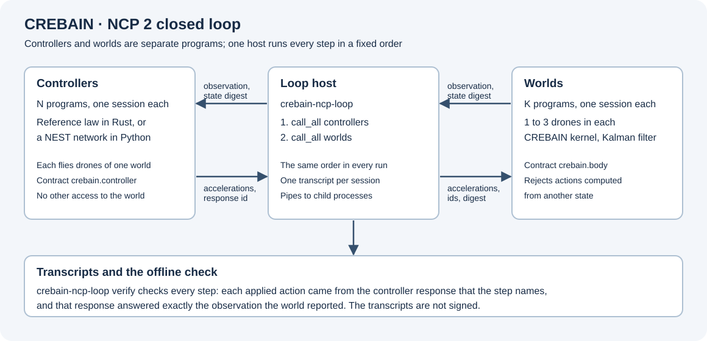

# Native NCP simulation

The `crebain-ncp-simulation` package carries the CREBAIN simulation kernel over NCP 2.
It has three programs:

- `crebain-ncp-simulation` owns one world of one to three simulated drones: one `crebain.body` session on its standard input and output.
- `crebain-ncp-controller` is the reference controller: one `crebain.controller` session that proposes accelerations with a fixed proportional-derivative law.
- `crebain-ncp-loop` is the host. It runs N controllers and K worlds in a closed loop, writes one transcript for each session, and checks the transcripts afterwards.

The programs open no network listener and supply no physical command authority.



Text alternative: The loop host runs controller programs and world programs, each with its own NCP 2 session over a pipe pair.
In each step, every controller receives the latest observation and state digest of its drones and returns accelerations.
Every world then applies the accelerations of its controllers, names their response identities and the state that they answered, and declines actions computed from another state.
Every session writes a transcript, and an offline check confirms each link of the chain.

## Build and pin

The package has a separate workspace and lockfile.
It uses the NCP 2 Rust core, package `sepahead-ncp-core` (library `ncp`), version `=2.0.0`, at the immutable NCP revision `2e24ef5b89feb3f1e4f4972e290201d93e2d0a8d`, which implements revision 4 of the NCP 2 specification.
Its lockfile resolves that same public Git revision and version.
The package does not permit a sibling path or a patch override.

<!-- ncp2-pin: 2.0.0 2e24ef5b89feb3f1e4f4972e290201d93e2d0a8d -->

```bash
cargo build --locked --release \
  --manifest-path src-tauri/crates/ncp-simulation/Cargo.toml
```

NCP 2 owns the framing, the request and response identities, the order of requests, and the kept response that answers a repeated request, so each request runs at most once.
The two contracts are exact JSON documents in [`contracts`](../src-tauri/crates/ncp-simulation/contracts): `crebain.body.v1.json` and `crebain.controller.v1.json`.
A session opens only with the SHA-256 identity of its contract's exact bytes.
The [kernel document](NATIVE_SIMULATION_KERNEL.md) defines the reused numerical implementation.

## The world: `crebain.body`

`prepare` admits one to three drones with sorted, unique identifiers, a step of 1 to 1000 integral milliseconds, and 1 to 1024 planned steps.
It takes three ENU position components, three velocity components, and three positive visual sensor variances for each drone.
An optional frozen schedule holds at most 256 rows sorted by `(step, drone_id)`.
Each row fixes, for one drone at one step, a sensor offset of at most 50 meters per component, the sensor's availability, and the actuator's availability.
Steps without a row admit the sensor and the actuator without an offset.
No step accepts a fault or environment override.
The world declines a request with non-finite numbers or negative zero.

The kernel runs every session with the same run label, `crebain.ncp2-body`.
Equal inputs therefore give equal state digests in every run; the NCP session identifier distinguishes the runs.

Every `prepare` and `step` result holds the kernel's frame, its Kalman innovation diagnostics, and an observation.
The observation gives, for each drone, the filter's estimated position and velocity when its sensor was admitted and its estimate is available.
Otherwise it gives `false` and zeros for that drone.
The frame keeps the true positions, the proposed and applied accelerations, and saturation separately.

A `step` names the next step, the state digest of the observation that its actions were computed from, three accelerations for each drone, and its proposals.
Each proposal names the identity of one controller response and the drones that it moves.
Every drone is in exactly one proposal, and no response identity appears twice.
A step whose state digest is not the world's current state digest is declined.
`finish` requires the complete planned step count and returns the kernel's finish record with its cleanup status.
After `finish`, the session accepts no further operation.

A declined request never runs and changes nothing, and the same session goes on (NCP 2, outcome `declined`, rule 7.3.12).
A failure after admission ends the session with `owner_failure` and clears the world.

## The controllers: `crebain.controller`

`prepare` gives a controller one to three drones of one world, the step length, one target position for each drone, and the controller's own parameters.
Each `step` gives the world's observation of exactly those drones, with the step index and the state digest.
The result echoes the step index, the digest, and the drones, and proposes three finite accelerations of at most 50 m/s² for each drone, without negative zero.

The reference controller proposes `a = kp (target - position) - kd velocity` for each axis, limited to `max_acceleration_mps2`, and zero for a drone without an estimate.
Its defaults are `kp` 1.0, `kd` 2.0, and a limit of 5 m/s².
The [NEST controller](../integrations/ncp2-nest-controller/README.md) implements the same contract with a spiking network.

## The closed loop

`crebain-ncp-loop run CONFIG.json OUT_DIR` reads one JSON configuration:

| Member | Meaning |
| --- | --- |
| `tick_ms`, `steps` | The step length in milliseconds and the number of steps. |
| `body_command` | The world program and its arguments. |
| `worlds` | For each world, its drones in identifier order, each with `id`, `initial_position_m`, optional `initial_velocity_mps`, `sensor_variance_m2`, and `target_m`, and an optional `schedule`. |
| `controllers` | For each controller, its `command`, the index of its `world`, its sorted `drone_ids`, and its `parameters`. |

Every drone has exactly one controller, and every controller flies drones of one world.
One world can have several controllers, so N controllers can fly M drones in K worlds.
A program name without a path is looked up next to `crebain-ncp-loop` first.

In each step, the host first sends every controller its observation, and the controllers work at the same time.
It then sends every world its accelerations and proposals.
The order is the same in every run, so a repeated run gives the same results.

Each transcript records a request before the host sends it, so it holds every request that a world or a controller may have executed.
The output directory receives one transcript for each session (`world-K.ncpt`, `controller-N.ncpt`), `manifest.json`, `trajectory.jsonl` with the true and the estimated positions of each step, and `summary.json` with the final distance of each drone from its target.

`crebain-ncp-loop verify OUT_DIR` checks the transcripts with the NCP 2 transcript verifier and then checks the whole chain.
Every controller request must equal the world's previous observation of its drones.
Every world step must name the state of that observation, and its accelerations must equal the named responses' accelerations bit for bit.
Every controller response must be applied exactly once, and every world must finish from its last state.
The transcripts are not signed. The check finds damaged and inconsistent records, not a complete and consistent forgery of every file.

## Verification

```bash
bun run check:ncp-coherence
bun run validate:ncp-simulation
```

The offline coherence check joins the native manifest, lock version, exact Git source, and documentation marker.
It separately checks the wire-1.0 dependency pins of the application (the untagged 1.0.0-rc.1 candidate).
The native aggregate checks formatting, release compilation, all-target tests, doctests, strict Clippy, and Rust documentation.
Both `validate:all` and the existing Rust CI job invoke this aggregate.
The existing supply-chain job separately audits this package with `src-tauri/deny.toml`, which admits Git sources only from the NCP repository.

The tests run the actual kernel:

- one, two, and three drones through the world match direct kernel execution frame for frame, innovations included;
- the frozen schedule drops sensors and holds actuators exactly as the kernel does, and a dropped sensor hides the estimate;
- invalid preparations and steps are declined without a change, each followed by a valid request as a positive control;
- a repeated request frame gets the kept response and advances the world once;
- the world program answers anything but an NCP frame with `bad_frame` and takes no arguments;
- the reference law, its limits, and the checks of controller results;
- closed loops of one controller with one drone and of three controllers with five drones in two worlds, which reach their targets, verify, and repeat identically;
- a changed transcript byte, a wrong manifest, or a missing transcript fails the check, and a bad assignment fails before any program starts.

The optional [NEST check](../integrations/ncp2-nest-controller/README.md) runs the loop with spiking networks in NEST.
These tests do not establish physical drones, physical safety, calibrated estimation, control performance beyond the stated runs, or installed interoperability with Engram.

The previous native body used the NCP 1 local SDK (`ncp-local` 1.0.1) with the profile `crebain.local-kinematic-kalman.v1`; the Git history keeps it.
