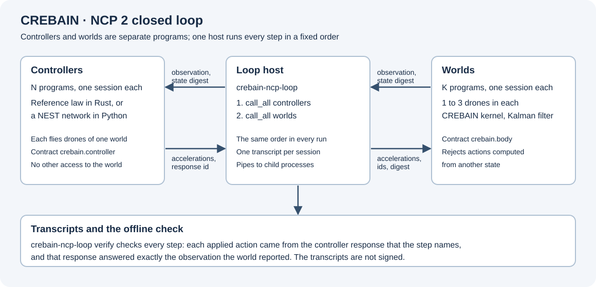
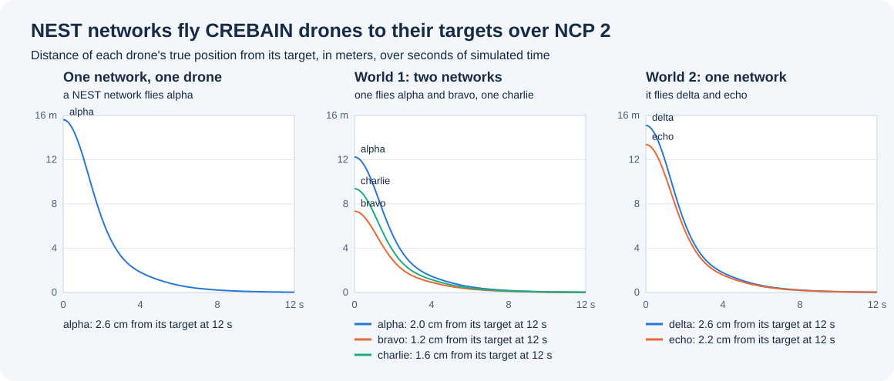

# NEST controller for the NCP 2 loop

`nest_controller.py` is a `crebain.controller` owner whose controller is a spiking network in NEST.
It lets neural networks fly CREBAIN's simulated drones through the [NCP 2 closed loop](../../docs/NATIVE_NCP_SIMULATION.md): one network with one drone, or several networks with several drones in several worlds.
It serves one NCP 2 session on its standard input and output.



Text alternative: The loop host runs controller programs, such as this NEST controller, and CREBAIN world programs, each with its own NCP 2 session.
In each step, every controller receives the latest observation of its drones and returns accelerations, and every world applies them only if they answer its current state.
Every session writes a transcript, and an offline check confirms each link of the chain.

## The network

For each drone and each axis, two populations of leaky integrate-and-fire neurons (NEST's `iaf_psc_alpha`, 50 each by default) carry the proportional-derivative signal

`u = kp (target - position) - kd velocity`, in m/s².

The `+` population receives the current `drive * max(u, 0)` and the `-` population `drive * max(-u, 0)`.
Both add these to a bias current that differs from neuron to neuron, from 400 to 500 pA.
The bias lies above the firing threshold of 375 pA, so both populations fire at rest and a small error changes their rates in proportion.
After each step of simulated time, the controller counts the spikes of each population and proposes, for each axis,

`a = gain * (spikes+ - spikes-) / neurons`, limited to `max_acceleration_mps2`.

A drone without an estimate gets zero acceleration, as with the reference controller.
The network keeps its state from step to step.
NEST runs on one thread with a fixed seed, so a repeated run gives the same spikes.

This is a minimal spiking controller that puts a neural network into the loop.
It is not a model from Engram or from the literature, and it claims nothing about neural control.

## Parameters

`prepare` takes these members in `parameters`; each has a default.

| Member | Default | Meaning |
| --- | ---: | --- |
| `kp` | 1.0 | Proportional gain, 1/s² |
| `kd` | 2.0 | Derivative gain, 1/s |
| `max_acceleration_mps2` | 5.0 | The largest acceleration component proposed, above 0 and at most 50 |
| `neurons` | 50 | Neurons in each population, 1 to 1000 |
| `bias_pA` | [400, 500] | The range of the bias currents, in pA |
| `drive_pA_per_mps2` | 100 | The current for 1 m/s² of `u`, in pA |
| `gain_mps2_per_spike` | 1.6 | The acceleration for one spike per neuron of difference, in m/s² |
| `seed` | 1 | NEST's random seed |

## Run it

It needs NEST 3.10 (PyNEST) and the NCP 2 Python SDK, package `sepahead-ncp` (module `ncp`), on the module path.
Name it in a loop configuration as the program of a controller, for example `"command": ["PYTHON", "integrations/ncp2-nest-controller/nest_controller.py"]`, where `PYTHON` has NEST, and give the loop `PYTHONPATH` for the SDK.

`check.py` runs the whole check:

```bash
CREBAIN_NCP_PYTHON=NCP_CHECKOUT/python CREBAIN_NEST_PYTHON=PYTHON_WITH_NEST bun run validate:ncp2-nest
```

`NCP_CHECKOUT` is an NCP checkout at the revision that [the native simulation pins](../../docs/NATIVE_NCP_SIMULATION.md#build-and-pin).
The check first tests the controller's validation and readout with a stand-in network.
It then builds the native programs and runs two loops of 600 steps of 20 ms: one network with one drone, and three networks with five drones in two worlds.
Every drone must end within 0.1 m of its target, `crebain-ncp-loop verify` must accept the transcripts, and a second run of the first loop must give the same summary.
With `--evidence DIR`, it writes the summaries, the verification reports, the trajectories, and the environment into a new directory.

## Results of 12 November 2026

`check.py --evidence` ran from the clean CREBAIN commit `d0a3c28` with NEST 3.10.0 on Python 3.11.15 and the NCP 2 Python SDK of NCP commit `9e0696b`, on an Apple M4 Max with macOS.
The [evidence](evidence/2026-11-12) holds the summaries, the verification reports, the trajectories of every step, and the environment; [`figure.py`](figure.py) draws the figure from them.



Text alternative: Three line charts show the distance between each drone's true position and its target over 12 seconds of simulated time.
In each, every drone starts between 7.3 and 15.6 meters away and ends between 1.2 and 2.6 centimeters away.

| Loop | Drone | Start, m | End, cm |
| --- | --- | ---: | ---: |
| One network, one drone | alpha | 15.62 | 2.6 |
| World 1: one network flies alpha and bravo, one charlie | alpha | 12.25 | 2.0 |
| | bravo | 7.35 | 1.2 |
| | charlie | 9.38 | 1.6 |
| World 2: one network flies delta and echo | delta | 15.10 | 2.6 |
| | echo | 13.38 | 2.2 |

- `crebain-ncp-loop verify` accepted every transcript: 600 controller responses in the first loop and 1,800 in the second, each applied once, from the state that it answered.
- A second run of the first loop gave the same summary, final state digest included.
- The controllers only received the filter's estimates; the distances above use the true positions, which the controllers never saw.

## What this does not show

- Real drones, physical safety, or control quality beyond the stated runs.
- An Engram network: Engram can implement the same contract with its own models.
- Timing: NEST simulates each step as fast as it can; nothing here runs in real time.
